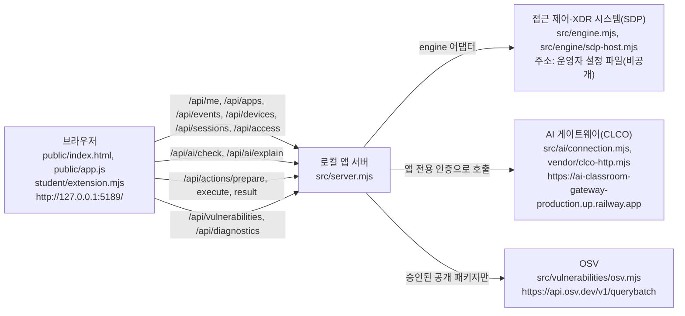

# 케셰브(내 보안 Agent) 학생용 실행 설명서와 시스템 구성도

이 문서는 학생이 직접 작성한 설명서입니다. 제공 문서(README.md, docs/STUDENT_LAUNCH_GUIDE.md 등)는 고치지 않았습니다.

## 0. 이 문서의 표기

모든 항목 앞에는 어떻게 알게 된 내용인지 표시합니다. 표시가 없는 설명은 없습니다.

| 표기 | 뜻 |
|---|---|
| [실행 확인] | 이 문서를 쓰면서 이 PC에서 실제로 실행해 결과를 봤습니다. |
| [모의 입력] | 가짜 DOM과 모의 데이터로 함수만 돌려 봤습니다. 실제 브라우저 화면이 아닙니다. |
| [코드 확인] | 소스 파일을 읽고 확인했습니다. 실행하지 않았습니다. |
| [미확인] | 확인하지 못했습니다. 되는 것처럼 읽으면 안 됩니다. |

확인한 날짜는 2026-10-26이고, 확인한 PC는 Windows 11 Pro 10.0.26200입니다.

## 1. 목적과 기능

케셰브는 회사 직원이 자기 로그인 상태, 업무 앱 접속 판정, 최근 접속 기록과 보안 경보, 앱 안의 AI 설명, 설치 패키지의 알려진 취약점 조회를 한 화면에서 보는 보안 앱입니다. 내 PC에서만 열리는 로컬 앱입니다. [코드 확인]

화면에서 하는 일은 다음과 같고, 각 학생 칸은 `student/extension.mjs`의 함수가 그립니다.

| 화면 | 학생 함수 | 하는 일 |
|---|---|---|
| 내 계정 | `renderIdentity` | 로그인 사용자, 기기, 세션과 그 상태를 보여 줍니다. |
| 업무 앱 접근 판정 | `renderDecision` | 허용·거부·추가 확인·확인 불가 판정과 이유를 보여 줍니다. |
| 보안 기록 | `renderEvents` | 접속 기록과 XDR 경보를 필터로 좁혀 보고 사건 상세를 봅니다. |
| 보호 현황 | `renderStatus` | 기기·세션 목록, 알림, 진단 정보와 도움정보 복사를 보여 줍니다. |
| AI 연결 | `renderAiConnection` | 모델 응답 점검 결과와 오류 원인을 보여 줍니다. 사건 설명은 아직 실행하지 않았다고 구분합니다. |
| AI 사건 설명 | `renderExplanation` | AI 요약을 선택한 사건의 근거·규칙·확인 불가 상태와 함께 보여 줍니다. |
| 조치 상태 | `renderAction` | 제안·사람 확인·서버 접수·실제 효과 관측을 구분해 보여 줍니다. 버튼은 없습니다. |
| 설치 패키지 조회 | `renderVulnerabilities` | package-lock.json의 정확한 버전과 OSV 조회 결과, 미조회·일부 실패를 구분합니다. |

## 2. 지원 환경과 버전

| 항목 | 값 | 근거 |
|---|---|---|
| 프로젝트 버전 | 0.2.11 (`alekov-client-starter`) | package.json [코드 확인] |
| Node.js | v24.19.0 | `node --version` 출력 [실행 확인] |
| Node.js 요구 | `engines.node`는 24.19.0, 실행 도구는 22~24를 허용 | package.json, tools/start-alekov.ps1 [코드 확인] |
| Git | 2.55.0.windows.5 | `git --version` 출력 [실행 확인] |
| 운영체제 | Windows 11 Pro 10.0.26200 | 이 PC [실행 확인] |
| 외부 npm 패키지 | 없음 (`npm install` 불필요) | package.json에 dependencies 없음 [코드 확인] |

지원하지 않거나 확인하지 못한 환경은 다음과 같습니다.

- macOS, Linux: 실행 도구가 PowerShell 스크립트(tools/start-alekov.ps1)라서 지원 대상으로 보지 않습니다. [미확인]
- Node.js 22, 23: 실행 도구는 허용하지만 이 PC에서 실행하지 않았습니다. [미확인]
- 다른 PC나 새 폴더에서의 재현: [미확인] (22단계에서 확인합니다.)

## 3. 폴더 구조와 작업 위치

앱 폴더는 `package.json`과 `src\server.mjs`가 들어 있는 `on-client` 폴더입니다. 폴더가 놓인 위치는 PC마다 다르므로 이 문서에는 절대경로를 적지 않습니다. 아래 "앱 폴더"는 이 폴더를 말합니다.

이 PC에서는 앱 폴더 자체가 Git 저장소의 최상위입니다 (`git rev-parse --show-toplevel` 결과가 앱 폴더). [실행 확인] 제공 문서 STUDENT_LAUNCH_GUIDE.md는 저장소 최상위가 앱 폴더의 위 폴더라고 설명하지만, 이 PC에서는 다릅니다. 커밋과 제출 준비는 이 PC의 실제 최상위 기준으로 합니다.

Git이 추적하는 파일 (`git ls-files` 기준) [실행 확인]:

```
on-client/
├─ package.json                     실행·검사 스크립트 (start, demo, check)
├─ .env.example                     비밀 없는 설정 견본
├─ .gitignore                       .env, node_modules, *.log 제외
├─ README.md                        제공 문서
├─ docs/                            제공 문서들 + STUDENT_RUNBOOK.md(이 문서, 학생 작성)
├─ tools/start-alekov.ps1           실행 도구 (그 밖의 .ps1은 운영자 안내가 있을 때만 사용)
├─ src/
│  ├─ server.mjs                    로컬 앱 서버 (127.0.0.1)
│  ├─ engine.mjs                    접근 제어·XDR 엔진 연결 로더와 예제 엔진
│  ├─ engine/                       SDP 호스트 연결 (sdp-host.mjs, sdp-host-config.mjs)
│  ├─ ai/                           AI 게이트웨이 연결·승인·점검·설명
│  ├─ connection/                   계정 연결(native login)
│  ├─ actions/                      조치 준비·집행·결과 조회
│  ├─ vulnerabilities/              package-lock.json 읽기와 OSV 조회
│  └─ learner-support/              도움정보
├─ public/                          브라우저 화면 (index.html, app.js, style.css 등)
├─ student/
│  ├─ extension.mjs                 학생이 작성한 화면 함수 (13~20단계)
│  └─ engine-adapter.mjs            엔진 연결 어댑터 견본 (수정하지 않음)
└─ vendor/clco-http.mjs             AI 게이트웨이 호출 부품
```

## 4. 실행 절차

### 4-1. 실행 전에 필요한 것

1. Node.js 24.19.0: 새 PowerShell 창에서 `node --version`을 실행해 `v24.19.0`이 나오는지 봅니다. [실행 확인: 이 PC에서 v24.19.0]
2. 없으면 https://nodejs.org 에서 설치하고 PowerShell 창을 새로 엽니다. [코드 확인: 실행 도구의 안내 문구]

### 4-2. PowerShell을 여는 위치

파일 탐색기에서 앱 폴더(`on-client`)를 열고, 주소 표시줄에 `powershell`을 입력한 뒤 Enter를 누릅니다. 앱 폴더에서 PowerShell이 열립니다. [코드 확인: 제공 문서 안내. 이 방법 자체는 실행하지 않았습니다.] 이미 연 PowerShell이라면 `cd`로 앱 폴더에 들어가면 됩니다.

### 4-3. 실행 명령

```powershell
powershell -NoProfile -ExecutionPolicy Bypass -File .\tools\start-alekov.ps1
```

- 이 명령은 `src/server.mjs` 하나를 실행합니다. 프로그램 설치, 전역 정책 변경, 다른 프로그램 종료는 하지 않습니다. [코드 확인]
- 기본 실행은 접근 제어·XDR 시스템과 AI 게이트웨이에 연결하지 않은 상태입니다. [실행 확인: 5-4의 응답]

실제로 실행해 확인한 형태는 임시 포트와 백그라운드 옵션을 쓴 아래 명령입니다. [실행 확인]

```powershell
powershell -NoProfile -ExecutionPolicy Bypass -File .\tools\start-alekov.ps1 -Port 5199 -Background
```

기본 포트(5189)로 창에 붙여 실행하는 형태(위 명령)는 이 문서를 쓰면서 실행하지 않았습니다. [미확인]

### 4-4. 정상 시작 신호

실행 도구가 다음 두 줄을 출력합니다. 이 문구는 tools/start-alekov.ps1 소스에서 읽은 것입니다. [코드 확인] 실제 실행에서는 두 줄과 프로세스 번호 줄이 출력됐지만, 캡처한 출력에서 한글이 깨져 보여 글자 하나하나를 대조하지는 못했습니다. 그러므로 문구 일치는 [미확인]이고, 줄 수와 순서만 [실행 확인]입니다.

```
케셰브가 켜졌습니다. 브라우저에서 http://127.0.0.1:5189/ 을 여세요.
서버가 응답한 것만 확인했습니다. AI 연결 상태는 화면에서 따로 확인해 주세요.
```

- 두 번째 줄 그대로, 서버가 응답한 것만 확인한 것입니다. AI 연결 성공이나 계정 연결 성공이 아닙니다.
- 서버 자체도 `케셰브 연결 확인: http://127.0.0.1:5189` 한 줄을 출력합니다. [코드 확인: src/server.mjs] 창에 붙여 실행했을 때 이 줄이 보이는지는 [미확인]입니다.
- 창이 아닌 `-Background`로 실행하면 `프로세스 번호`가 함께 출력됩니다. [실행 확인]

### 4-5. 브라우저 주소

`http://127.0.0.1:5189/` (포트를 바꿨다면 바꾼 번호). 서버는 `127.0.0.1`에서만 응답하고, 허용된 Host 헤더 `127.0.0.1:포트`, `localhost:포트`만 받습니다. [코드 확인: src/server.mjs]

- 서버 응답: 임시 포트 5199에서 `GET /` → HTTP 200. [실행 확인]
- 브라우저에서 위쪽 상태 표시와 「보호 현황」 화면이 보이는지: [미확인]

### 4-6. 종료

- 창에 붙여 실행했을 때: 그 창에서 `Ctrl+C`. [코드 확인: 실행 도구 안내. 실행하지 않음 — 미확인]
- `-Background`로 실행했을 때: 출력된 프로세스 번호의 node를 종료합니다. 이 문서를 쓰면서 `Stop-Process -Id <프로세스 번호> -Force`로 종료했고, 이후 같은 포트에서 응답이 없었습니다. [실행 확인]
- 실행과 종료는 내 파일을 바꾸지 않습니다. 실행 전후 `git status --short` 결과가 비어 있었습니다. [실행 확인]

### 4-7. 다시 실행

종료한 뒤 4-3의 명령을 같은 앱 폴더에서 다시 실행합니다. 포트를 다른 프로그램이 쓰고 있다고 나오면 그 프로그램은 두고 `-Port 5190`처럼 다른 번호를 붙이고, 브라우저 주소도 같은 번호로 엽니다. [코드 확인]

### 4-8. 그 밖의 명령

| 명령 | 하는 일 | 확인 |
|---|---|---|
| `npm run check` | `node --check student/extension.mjs`로 student/extension.mjs의 문법만 검사 | 오류 없이 끝남 [실행 확인] |
| `npm start` | `node src/server.mjs` 실행 (실행 도구와 달리 Node 버전과 포트를 미리 확인하지 않음) | [미확인] |
| `npm run demo` | 예제 자료로 실행. 실제 연결이 아님 | [미확인] |
| `... -NativeHostConfig`, `-SdpHostConfig` | 운영자가 안내한 설정 파일로 계정 연결·SDP 연결을 켬 | [미확인] (설정 파일을 받지 않았습니다. 경로와 내용은 이 문서에 적지 않습니다.) |

## 5. 시스템 구성도

### 5-1. 글로 쓴 구성도

```
[브라우저]
  public/index.html, public/app.js, student/extension.mjs
  주소: http://127.0.0.1:5189/
      │  HTTP (같은 PC, 127.0.0.1만)
      ▼
[로컬 앱 서버]
  src/server.mjs  (포트 기본 5189, 환경변수 ON_PORT)
  - 브라우저에 화면 파일을 내려 줌
  - /api/... 요청을 받아 아래 두 곳과 OSV로 전달
      │                                 │                          │
      ▼                                 ▼                          ▼
[접근 제어·XDR 시스템]            [AI 게이트웨이(CLCO)]       [OSV 취약점 DB]
  src/engine.mjs                   src/ai/connection.mjs      src/vulnerabilities/osv.mjs
  src/engine/sdp-host.mjs          vendor/clco-http.mjs       https://api.osv.dev/v1/querybatch
  student/engine-adapter.mjs       https://ai-classroom-       허용 패키지 목록이 있을 때만
  주소: 운영자가 준 설정 파일에만   gateway-production.         조회
  있음(문서에 적지 않음)            up.railway.app
```

### 5-2. Mermaid



### 5-3. 상자별 표

| 상자 | 실제 파일·주소 | 역할 | 이 PC에서 확인한 상태 |
|---|---|---|---|
| 브라우저 | `public/index.html`, `public/app.js`, `student/extension.mjs` / `http://127.0.0.1:5189/` | 화면을 그리고 `/api/...`를 호출. 학생 함수가 각 칸을 그림 | 서버가 `GET /`에 200으로 응답함 [실행 확인]. 브라우저 화면은 [미확인] |
| 로컬 앱 서버 | `src/server.mjs` / `127.0.0.1:5189` | 화면 파일 제공, API 중계, 오류를 안전한 코드로 변환 | 임시 포트 5199에서 기동·응답·종료 [실행 확인] |
| 접근 제어·XDR 시스템 | `src/engine.mjs`(`loadEngine`, `demoEngine`), `src/engine/sdp-host.mjs`, `student/engine-adapter.mjs` / 주소는 운영자 설정 파일에만 있고 적지 않음 | 사용자·기기·세션·업무 앱 판정·보안 기록의 원천 | 연결하지 않음. `GET /api/me`가 503, 코드 `ENGINE_NOT_CONNECTED`, `meta.mode`가 `disconnected` [실행 확인] |
| AI 게이트웨이(CLCO) | `src/ai/connection.mjs`의 `CLCO_GATEWAY_ORIGIN` = `https://ai-classroom-gateway-production.up.railway.app` | 앱 서버를 통해서만 수업용 AI에 연결 | 호출하지 않음. 연결·점검·설명 모두 [미확인] |
| OSV | `src/vulnerabilities/osv.mjs` / `https://api.osv.dev/v1/querybatch` | 승인된 공개 패키지의 정확한 버전으로 알려진 취약점을 조회 | 호출하지 않음. [미확인] |

### 5-4. 데이터 흐름 한 줄 요약

1. 브라우저가 앱 서버에 `/api/...`를 요청합니다. 학생 모듈은 `/student/extension.mjs`로 불러옵니다. [코드 확인: public/app.js]
2. 앱 서버는 엔진 어댑터가 없으면 `ENGINE_NOT_CONNECTED`를 돌려줍니다. [실행 확인]
3. `public/app.js`가 응답을 검증한 뒤 `{status, mode, data, error}` 형태로 학생 함수에 넘기면, 학생 함수가 새 DOM을 만들어 반환합니다. 이전 결과는 다시 쓰지 않습니다. [코드 확인]
4. 앱 서버는 브라우저 요청에서 AI 주소나 열쇠를 받지 않습니다. 열쇠·토큰은 문서와 화면에 적지 않습니다. [코드 확인]

## 6. 제공 코드와 학생 작성 부분

### 6-1. 파일 경계

| 구분 | 파일 | 설명 |
|---|---|---|
| 제공 (수정하지 않음) | `src/**`, `public/**`, `vendor/**`, `tools/**`, `package.json`, `.env.example`, `docs/`의 제공 문서 | 서버, 화면 골격, 검증, 연결 도구 |
| 학생 작성 | `student/extension.mjs` | 13~20단계에서 작성한 화면 함수 8개 |
| 학생 작성 | `docs/STUDENT_RUNBOOK.md` | 이 문서 |
| 제공 견본 (이번에 수정하지 않음) | `student/engine-adapter.mjs` | 엔진 연결 어댑터 견본. `student/` 폴더에 있지만 학생이 작성한 기능이 아님 |

`.on-starter-manifest.json`은 시작 틀이 제공한 파일 56개의 해시 목록입니다. `student/extension.mjs`와 `student/engine-adapter.mjs`도 제공 당시의 해시로 들어 있고, 제공 영역과 학생 영역을 구분해 적은 목록은 아닙니다. [코드 확인] 그래서 위 표의 구분은 이 파일이 아니라 파일 위치와 Git 기록(`student/extension.mjs`를 고친 13~20단계 커밋)을 기준으로 한 것입니다. `docs/STUDENT_RUNBOOK.md`는 이 목록에 없는 새 파일입니다. [코드 확인]

### 6-2. 학생 함수 8개

| 함수 | 입력 | 보여 주는 것 | 확인 수준 |
|---|---|---|---|
| `renderIdentity` | `{me, devices, sessions}` | 사용자·기기·세션과 상태. 값이 정상이 아니면 글자 앞에 `[주의]`를 붙임 | 모의 입력 점검 기록 없음 [미확인] (13단계 작성) |
| `renderDecision` | `{status, mode, data, error, appId}` | `[허용]`, `[거부]`, `[추가 확인 필요]`, `[확인 불가]`. 모르는 판정은 허용으로 읽히지 않게 확인 불가 처리 | [미확인] (14단계 작성) |
| `renderEvents` | `{status, mode, data, error}` | 최신순 기록 목록, 종류·앱·접속 상태 필터, 사건 상세(근거·규칙·미지원 조치) | [미확인] (15단계 작성) |
| `renderStatus` | `{devices, sessions, notifications, diagnostics, mode}` | 기기·세션·알림, 허용된 진단 필드, 「도움정보 복사」 | [미확인] (16단계 작성) |
| `renderAiConnection` | `{status, mode, data, error, checkedAt, explanationAccepted}` | `[점검 전]`, `[점검 중]`, `[모델 응답 확인]`(test/verified), 오류 코드별 원인과 안내. 사건 설명은 실행하지 않았다고 명시 | 모의 입력 [모의 입력] |
| `renderExplanation` | `{event, explanation, checkedAt}` | 성공한 설명에만 `data-student-explanation-event`를 붙이고 근거·규칙·확인 불가 상태·제안을 표시. 근거가 맞지 않으면 사용 불가 | 모의 입력 [모의 입력] |
| `renderAction` | `{status, event, actionId, target, receipt, observation, message, confirmationExpiresAt, error}` | 11개 상태. `succeeded`이고 `effectApplied === true`일 때만 `[효과 확인]`. 그 외는 `[결과 불명]` | 모의 입력 [모의 입력] |
| `renderVulnerabilities` | `{status, mode, data, error}` | `data.status` 5종, 잠금 파일 버전·해시, 패키지별 정확한 버전과 취약점 id·modified | 모의 입력 [모의 입력] |

모든 함수는 `createElement`와 `textContent`만 쓰고, 호출될 때마다 새 DOM을 반환하므로 이전 결과가 현재 결과처럼 남지 않습니다. [코드 확인]

모의 입력 점검은 가짜 DOM으로 함수를 직접 호출한 것이며, 실제 브라우저에서 칸이 보이는지는 [미확인]입니다.

## 7. 오류별 확인 순서

화면에 실제로 나오는 문구 기준입니다. 문구는 소스에서 읽었고, 그중 `ENGINE_NOT_CONNECTED`만 실제 응답으로 확인했습니다.

| 화면 문구 | 원인 | 먼저 확인할 것 | 근거 |
|---|---|---|---|
| `연결 없음`, 코드 `ENGINE_NOT_CONNECTED`, "기존 서버·에이전트의 연결을 확인할 수 없습니다. 연결 어댑터를 먼저 확인하세요." | 이 실행에 접근 제어·XDR 연결이 켜지지 않음 (기본 실행) | `-SdpHostConfig`로 실행했는지. 설정 파일은 운영자가 안내합니다 | 응답 [실행 확인] |
| `예제 자료 (실제 연결이 아님)` | `-Demo` 또는 `npm run demo` 실행 | 예제 값은 실제 연결 결과가 아니므로 성공으로 적지 않음 | [코드 확인] |
| `확인 불가 (연결 상태를 확인할 수 없음)` | 연결 모드를 알 수 없음 | 다시 불러오기를 직접 한 번 누르고, 계속되면 도움정보를 담당자에게 | [코드 확인] |
| `[점검 실패] 권한 준비 중`, 코드 `ON_AI_PROVISIONING_PENDING` | 운영 측 계정·앱 권한 준비가 끝나지 않았거나 확인 불가 | 계정 연결과 AI 연결 승인을 마쳤는지. 학생 설정 오류가 아니므로 담당자에게 확인 요청 | [코드 확인] |
| `[점검 실패] 인증 실패`, `접근 제한` (`WB_CLCO_AUTH_REQUIRED`, `WB_CLCO_ACCESS_BLOCKED`) | 앱 인증 또는 이용 권한 문제 | 계정 연결을 다시 확인. 열쇠를 복사해 붙이지 않음 | [코드 확인] |
| `사용량·이용 한도 초과`, `이용 시간 아님` | 반 사용량·한도, 개방 시간 | 담당자에게 확인, 이용 시간 확인 | [코드 확인] |
| `요청 제한·시간 초과·네트워크` | 일시적 문제 | 잠시 뒤 「현재 API 연결 점검」을 직접 다시 누름. 자동 재시도 없음 | [코드 확인] |
| `[취소됨] 점검 취소` | 사용자가 취소 | 이전 결과는 현재 결과가 아님 | [코드 확인] |
| `사용 가능한 모델 없음` | 앱 권한으로 쓸 모델이 없음 | 담당자에게 모델 허용 설정 확인 요청 | [코드 확인] |
| `[설명 실패] AI 설명 실패`, `[설명 사용 불가]` | AI 설명 호출 실패, 또는 근거 ID·실행 표시가 선택한 기록과 맞지 않음 | 기록은 그대로입니다. 「AI 설명 요청」을 직접 다시 누름 | [코드 확인], 모의 입력 |
| `[결과 불명]` (조치) | 결과를 알 수 없음 또는 `succeeded`인데 효과 관측이 없음 | 효과 없음으로도 성공으로도 판단하지 않음. 제공 화면의 「원천 결과만 재조회」를 직접 누름 | [코드 확인], 모의 입력 |
| `[조회 실패] 조회 실패: ...` (패키지) | 조회 오류·취소·시간 초과 | 이전 표는 현재 결과가 아님. 「설치 패키지 조회」를 직접 다시 누름 | [코드 확인], 모의 입력 |
| `[not_checked]`, `[not_configured]`, `[unverifiable]` (패키지) | 승인된 공개 조회 대상 없음 / 프로젝트 설정 필요 / lock 파일 확인 불가 | 취약점 없음이 아님. 허용 목록·대상 경로는 운영자가 준비하므로 학생이 설정을 바꾸지 않음 | [코드 확인], 모의 입력 |

실행 도구의 메시지는 다음과 같습니다. [코드 확인: tools/start-alekov.ps1]

| 메시지 | 확인할 것 |
|---|---|
| `Node.js 가 없습니다` / `지금 Node.js 는 vXX 입니다` | Node.js 24.19.0 설치, PowerShell 창 새로 열기 |
| `포트 5189 를 다른 프로그램이 쓰고 있습니다` | 그 프로그램은 두고 `-Port 5190`으로 실행 |
| `앱 폴더가 아닙니다` / `시작 틀 폴더가 아닙니다` / `바로가기(링크)로 연결된 폴더` | `on-client` 실제 폴더에서 실행 |
| `…초 안에 뜨지 않았습니다` | 창의 메시지 전체를 담당 강사에게 보여 줌 |

오류 코드 전체 목록과 운영자 확인 항목은 제공 문서 docs/CONNECTION_TROUBLESHOOT.md에 있습니다.

## 8. 확인한 것과 확인하지 못한 것

### 8-1. 이 PC에서 확인함

| 항목 | 결과 |
|---|---|
| `node --version` | v24.19.0 |
| `git --version` | 2.55.0.windows.5 |
| `npm run check` | 오류 없이 종료 |
| 실행 도구로 `-Port 5199 -Background` 기동 | 두 줄 안내와 프로세스 번호 출력, `GET /` → 200 |
| 연결 없는 기본 실행에서 `GET /api/me` | 503, `ENGINE_NOT_CONNECTED`, `meta.mode`가 `disconnected` |
| 프로세스 종료 | 같은 포트 응답 없음, 작업 트리 변경 없음 |
| 17~20단계 학생 함수 | 가짜 DOM과 모의 데이터로 상태별 출력 점검 (실제 화면 아님) |

### 8-2. 확인하지 못함 (기다림 항목 포함)

| 항목 | 이유 |
|---|---|
| 브라우저에서 화면 8개 칸의 실제 표시 | 이 문서 작성 중 브라우저로 열지 않음 |
| 기본 포트 5189 창 실행과 `Ctrl+C` 종료 | 임시 포트 백그라운드로만 실행 |
| `npm start`, `npm run demo`, `-Demo` | 실행하지 않음 |
| 계정 연결, AI 연결 승인, 「현재 API 연결 점검」 | 운영 측 계정 권한 준비 전이라 연결하지 않음. 권한 준비 중이면 기다림(UNV)이고 성공으로 적지 않음 |
| 실제 AI 사건 설명 | 유료 AI 요청을 하지 않음 |
| 조치 준비·집행·결과 재조회 | 현재 기록의 `supportedActions`가 비어 있어 처리 경로가 열리지 않음. 실제 학생 계정의 조치 결과는 기다림(UNV) |
| 실제 OSV 조회 | 승인된 공개 패키지 목록이 비어 있으면 `not_checked`가 정상. 외부 조회를 하지 않음 |
| SDP 연결(사용자·기기·세션·기록의 실제 값) | 개인 설정 파일을 받지 않음 |
| 13~16단계 학생 함수의 모의 점검 | 이번에 다시 돌리지 않음 |
| 다른 PC·새 폴더·Node 22~23에서의 재현 | 22단계에서 확인 |

OSV는 알려진 취약점 데이터베이스입니다. 조회 결과가 없다는 사실만으로 패키지나 앱 전체가 안전하다고 보장할 수 없습니다.
